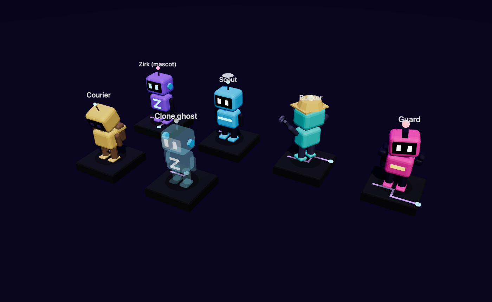
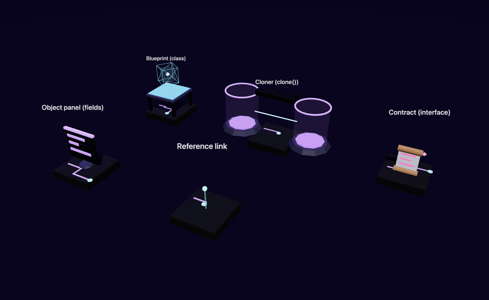

# Zirk game assets

Procedural Three.js assets for the Zirk learning game: characters, items,
goals, world tiles, props, effects and a set of props that give the
object-oriented lessons a visual vocabulary. Everything is built from code
(no external models or textures), uses the brand palette from
`zirk-lang-site/DESIGN.md`, and exports to `.glb` when another engine needs it.



## Quick start

```js
import * as THREE from 'three';
import { createBot, createTile, createCoin, createGoalPortal, createLights, createSky } from './src/index.js';

const scene = new THREE.Scene();
scene.add(createSky(), createLights().group);

const floor = createTile('grass', { variant: 2 });
const zirk = createBot('zirk').play('walk');
const coin = createCoin();
scene.add(floor, zirk, coin);

// In the render loop, give each animated asset its own time step:
function frame(dt) {
  for (const asset of [zirk, coin]) asset.update(dt);
}
```

Look at everything in the browser (Three.js is served from `node_modules`, so
it works offline):

```sh
npm install
npm run preview      # http://localhost:5173/  — orbit, switch categories, Export GLB
npm test             # model sanity, animation, determinism, API clamping
npm run shots        # regenerate preview/shots/*.png with Playwright
npm run export-check # proves GLB export works for every category in a real browser
```

## Conventions

| Topic | Rule |
| --- | --- |
| Units | One tile = 1 unit. A character is about 1.0 tall. |
| Origin | The asset's feet / base sit at `y = 0`; the walkable surface of a tile is `y = 0` with 0.2 below it. |
| Facing | Characters and props face `+Z`. `bot.face(angle)` rotates around `+Y`. |
| Shading | Flat-shaded `MeshStandardMaterial`, soft rounded boxes, emissive accents. |
| Animation | An asset with motion has `update(dt)`. Call it from your loop; assets never read the clock. |
| State | Interactive assets expose small, clamped setters (`open(0..1)`, `setLevel(0..1)`, `press(on)`), never raw internals. |
| Determinism | `createTile(type, { variant })`, sparkles and stars are seeded: same inputs, same look. |
| Memory | Materials and geometry are cached and shared. Call `disposeMaterialCache()` / `disposeGeometryCache()` once at teardown; per-asset `dispose()` only exists on assets that own GPU resources (sparkles, start pad, shadow blob). |

## Catalog (56 assets)

Every asset is in `CATALOG` (`src/catalog.js`); `createAsset(id, options)`
builds one by id.

| Category | Assets |
| --- | --- |
| **characters** | `bot-zirk` (mascot), `bot-scout`, `bot-builder`, `bot-guard`, `bot-courier`, `bot-ghost` (clone) |
| **items** | `coin` (stamped with the real Zirk mark, see `src/logo.js`), `gem`, `key`, `battery`, `chest`, `chip`, `orb` |
| **goals** | `goal-portal`, `flag`, `start-pad`, `checkpoint`, `door`, `plate`, `lever`, `terminal` |
| **world** | tiles `plain`, `circuit`, `grass`, `sand`, `ice`, `water`, `lava`, `hole`, `ramp`, `bridge`, `conveyor`, `teleporter`, `spikes`, plus `wall`, `pillar` |
| **props** | `crate`, `tree`, `pine`, `rock`, `crystal`, `lamp`, `sign`, `fence`, `bush`, `banner` |
| **effects** | `sparkles`, `shadow-blob`, `highlight-ring`, `path-arrow`, `trail-dot` |
| **teaching** | `blueprint`, `cloner`, `contract-scroll`, `object-panel`, `reference-link` |

The bots are a small class hierarchy on purpose: one skeleton (`Bot`), five
looks with different silhouettes, so the lessons on classes, inheritance and
polymorphism can point at something. `play('idle' | 'walk' | 'jump' |
'celebrate' | 'sad' | 'think')`; `jump` and `celebrate` return to idle.



## Mapping the browser interpreter's trace to assets

The interpreter's execution trace (`run` with `trace: {}`, ADR-022) describes
what happened in object terms. These assets are the intended rendering:

| Trace event / concept | Asset and call |
| --- | --- |
| `alloc` of a class | `createBot(kind)` placed on a `start-pad`; class → kind (`Scout`, `Builder`, …), id → label |
| `fieldWrite` on an object | `createObjectPanel({ fields })` → `panel.setField(index, ratio)` |
| `call` on a receiver | `createHighlightRing()` under the receiving bot, `bot.play('think')` or `'walk'` |
| `return` | `bot.play('celebrate')` for a successful return, `path-arrow` for the next call |
| `throw` | `bot.play('sad')`, `createSparkles({ color: PALETTE.error })` |
| `output` marker | `terminal` lights a line; `trail-dot` leaves a breadcrumb |
| a class / blueprint | `createBlueprint()` |
| an interface / contract | `createContractScroll()` → `unroll(progress)` while a class "signs" it |
| `clone()` | `createCloner()` → `setProgress(0..1)`, then `createBotGhost(kind)` beside the original |
| `is` / aliasing | `createReferenceLink()` between two bots that share one object |

## Art direction

Dark, precise and expressive, like the site: a near-black world with violet,
cyan, pink and aqua accents, glowing circuit traces on the floor, and warm gold
reserved for rewards (coins, keys, chests). Colors live in `src/palette.js`;
change a value there and every asset follows. All glow is a material property,
so no post-processing is required, though a bloom pass makes it sing.

## Accessibility notes for the game

The assets are decoration for a canvas that the site's WCAG AA requirements
treat as non-text content. The game still needs a text equivalent for every
state shown here (the execution trace is a ready-made transcript), keyboard
control, and a `prefers-reduced-motion` path: skip `update(dt)` for decorative
motion (coins, portals) and leave only state changes.

## Curriculum

`../ZIRK_LEARNING_GAME_CURRICULUM.md` is the level script for the basics of Zirk
(output, variables and types, values versus references, control flow,
functions, collections, `record`/`enum`/`Result`; no OOP): 7 sectors and 53
levels. The document is **executable**:

```sh
npm run curriculum:verify   # runs every solution in the browser interpreter, with a grid simulator
npm run curriculum:export   # regenerates curriculum/levels.json, the data the game loads
```

The verifier requires the interpreter example (`cargo build -p zirk-browser
--example interp_repro`). It checks that each reference solution solves its level
for every test case, that no starter already passes, that every documented
"common mistake" really produces the diagnostic the text promises, that the
glossary of diagnostics is exactly the set the levels exercise, and that the
language limits the script relies on still hold. The exporter refuses a level
without three hints, a concept, a story and a goal, or one that names an asset
not in `src/catalog.js`, and it never ships reference solutions.

## Layout

```
src/
  palette.js  materials.js  shapes.js   brand colors, cached materials/geometry, Asset base
  characters/bot.js                     the Bot family and its animations
  items/  goals/  world/  props/        collectibles, level logic, floor tiles, scenery
  effects/  teaching/                   particles and markers, OOP lesson props
  environment.js                        lights, sky dome, stars
  catalog.js  index.js                  the catalog and the public API
preview/                                browser preview, screenshots, GLB export check
curriculum/                             verifier and exporter of the level script, levels.json
test/                                   node:test suite
```

## Licence

Original work, released under the repository's Apache-2.0 licence. The only
dependency is Three.js (MIT).
